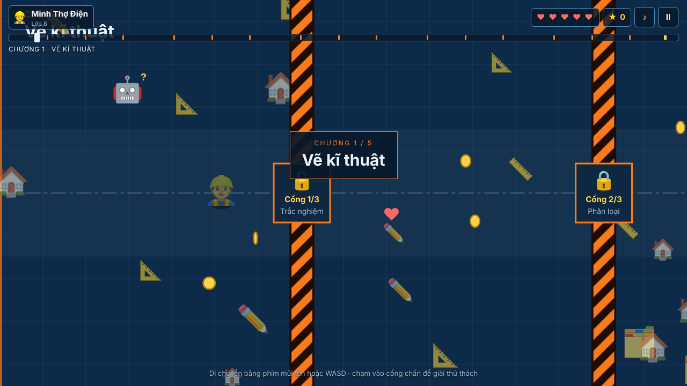
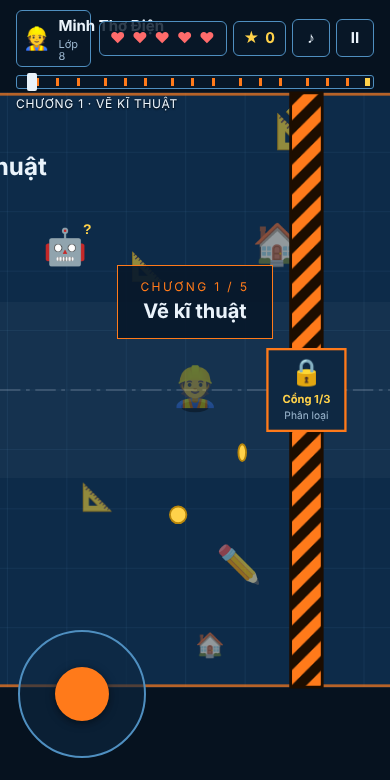
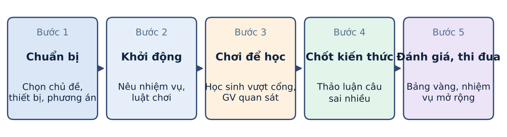

# 🎮 Hành Trình Công Nghệ

**Game nhập vai 2D ôn tập môn Công nghệ THCS (lớp 6, 7, 8, 9) – bộ sách *Kết nối tri thức với cuộc sống***

Một tệp HTML duy nhất, chạy trực tiếp trên trình duyệt (máy tính, điện thoại cấu hình thấp), không cần cài đặt, không cần mạng sau khi tải.

- **Chơi ngay:** https://nhainam-congnghe.github.io/hanhtrinhcongnghe/ *(sau khi bật GitHub Pages – xem mục 9)*
- **Tác giả:** Thầy Nguyễn Hải Nam – Trường PTDTBT TH&THCS Lâm Hoá, xã Tuyên Lâm
- **Đề tài sáng kiến:** “Đổi mới phương pháp dạy học môn Công nghệ THCS thông qua xây dựng và sử dụng trò chơi nhập vai 2D”

| Máy tính | Điện thoại |
|---|---|
|  |  |

---

## 1. Mục đích

- Biến việc **ôn tập, củng cố** kiến thức Công nghệ từ hình thức khô khan (đọc – chép – trả lời miệng) thành một **hành trình khám phá** có nhân vật, màn chơi, điểm thưởng và xếp loại.
- Phù hợp **điều kiện trường miền núi, vùng khó khăn**: ít thiết bị, mạng yếu, máy cấu hình thấp, học sinh chưa quen công nghệ số. Game chạy offline, nhẹ (một tệp, vài trăm KB), không cần tài khoản.
- Giúp học sinh **tự học, tự đánh giá** ngay trong giờ học, giờ tự học, ở nhà; giúp giáo viên có công cụ **kiểm tra nhanh, tạo thi đua** giữa các em, các lớp.

## 2. Phương pháp

| Thành tố | Cách thực hiện trong game |
|---|---|
| Học qua trò chơi (game-based learning) | Mỗi chương SGK là một màn chơi; mỗi “cổng” là một thử thách kiến thức. |
| Nhập vai | Học sinh chọn nhân vật (👷 🤖 🦊 🐼 🐯), đặt biệt danh, đi qua các chương để “trở thành Kĩ sư Công nghệ”. |
| Đa dạng định dạng tương tác | 8 kiểu thử thách: trắc nghiệm, ghép đôi, đúng/sai, sắp xếp thứ tự, điền khuyết, chọn ô, phân loại, giải mã từ khoá. |
| Phản hồi tức thì | Đúng/sai có lời giải thích ngắn; được thử lại; đáp án hiện ra để ghi nhớ. |
| Phân hoá | Chọn đúng lớp → đúng chương trình; câu hỏi có nhiều mức nhận thức (biết – hiểu – vận dụng). |
| Thi đua | Điểm số, chuỗi đúng, bảng xếp hạng cục bộ, giấy chứng nhận cuối hành trình. |
| Ngẫu nhiên hoá | Câu hỏi được bốc ngẫu nhiên từ ngân hàng, ưu tiên câu chưa gặp; đáp án, số liệu được xáo/sinh mới mỗi lượt. |

## 3. Nội dung kiến thức (theo chương trình Kết nối tri thức)

| Lớp | Các chương (màn chơi) |
|---|---|
| 6 | Nhà ở · Bảo quản và chế biến thực phẩm · Trang phục và thời trang · Đồ dùng điện trong gia đình |
| 7 | Trồng trọt · Lâm nghiệp · Chăn nuôi · Thủy sản |
| 8 | Vẽ kĩ thuật · Cơ khí · An toàn điện · Kĩ thuật điện · Thiết kế kĩ thuật |
| 9 | Nghề nghiệp kĩ thuật, công nghệ · Lựa chọn nghề nghiệp · Lắp đặt mạng điện trong nhà · Chế biến thực phẩm · Trồng cây ăn quả |

- Ngân hàng hiện có **161 câu/thử thách mẫu** (6: 38 · 7: 39 · 8: 43 · 9: 41), kèm một số câu **sinh số liệu ngẫu nhiên** (tính tỉ lệ bản vẽ, tỉ số truyền, công suất điện, sản lượng cá nuôi, …).
- Mỗi lượt chơi: **3 cổng/chương** (bốc từ ≥ 6 câu của chương) + **cổng cuối 4 câu** (bốc từ 10 câu tổng hợp).
- ⚠️ Nội dung câu hỏi do tác giả biên soạn, **cần giáo viên đối chiếu với SGK/giáo án** trước khi dùng chính thức và có thể bổ sung (xem mục 7).

## 4. Hướng dẫn chơi

1. Mở trang game → chọn **lớp (6–9)** → chọn **nhân vật** → nhập **biệt danh** → bấm **Bắt đầu**.
2. **Di chuyển:** máy tính dùng phím mũi tên hoặc **W A S D**; điện thoại dùng **cần điều khiển ảo** ở góc màn hình.
3. Thu **⭐ sao** (+10 điểm) và **❤️ vật phẩm** (hồi 1 năng lượng) rải trên đường.
4. Đến gần **nhân vật hướng dẫn** để đọc mẹo kiến thức của chương.
5. Chạm vào **cổng** để mở thử thách. Trả lời đúng → cổng mở, đi tiếp. Sai → mất 1 ❤️ và được thử lại.
6. Vượt hết các chương, đến **cổng cuối** (4 câu tổng hợp) để hoàn thành hành trình.
7. Hết 5 ❤️ trước khi tới đích: lượt chơi kết thúc, ôn lại và thử lại (câu hỏi sẽ khác).

**Cách làm từng dạng thử thách**

| Dạng | Cách làm |
|---|---|
| Trắc nghiệm | Chọn một đáp án đúng. |
| Ghép đôi | Chạm một mục ở cột trái rồi một mục ở cột phải để ghép. |
| Đúng/Sai | Đánh giá từng phát biểu. |
| Sắp xếp | Đưa các bước/giai đoạn về đúng thứ tự. |
| Điền khuyết | Chọn từ trong ngân hàng từ điền vào chỗ trống. |
| Chọn ô | Chạm chọn **tất cả** ô đúng trên lưới. |
| Phân loại | Xếp từng thẻ vào đúng nhóm. |
| Giải mã từ khoá | Sắp xếp các chữ cái/mảnh để ra thuật ngữ. |

## 5. Chấm điểm

| Mục | Điểm |
|---|---|
| Đúng ngay lần đầu ở cổng chương | **100** |
| Thưởng nhanh (cổng chương) | tối đa **+20**, trừ dần 1 điểm mỗi 2 giây suy nghĩ |
| Đúng ngay lần đầu ở cổng cuối | **50** (+ thưởng nhanh tối đa **+10**) |
| Chuỗi đúng liên tiếp | +5, +10, … tối đa **+25** mỗi câu |
| Đúng ở lần thử thứ hai (cổng chương) | **½** điểm gốc (cổng chương cho tối đa 2 lần thử; cổng cuối chỉ 1 lần) |
| Thu sao | **+10**/sao |
| Sai | **−1 ❤️** (tối đa 5 ❤️), chuỗi đúng về 0 |

## 6. Đánh giá, xếp loại

Xếp loại dựa trên **tỉ lệ câu đúng ngay lần đầu**:

| Tỉ lệ | Xếp loại | Danh hiệu | Sao |
|---|---|---|---|
| ≥ 90% | Xuất sắc | Kĩ sư Công nghệ | ★★★ |
| 75% – <90% | Giỏi | Thợ giỏi | ★★ |
| 55% – <75% | Khá | Thợ khá | ★ |
| < 55% | Cần cố gắng thêm | Thợ học việc | – |

Màn hình kết thúc hiển thị **giấy chứng nhận** (tên, lớp, điểm, tỉ lệ đúng, thời gian, năng lượng còn lại, số sao) và **bảng xếp hạng** top 5 lưu ngay trên thiết bị (localStorage). Giáo viên có thể chụp màn hình kết quả của học sinh để theo dõi và tổ chức thi đua.

## 7. Cách thức triển khai trong dạy học

**Quy trình 5 bước:** 

1. **Khởi động** (3–5 phút) – giáo viên giới thiệu chủ đề, mục tiêu.
2. **Dạy kiến thức mới** theo giáo án như bình thường.
3. **Chơi củng cố** (10–15 phút) – học sinh chơi màn chơi tương ứng.
4. **Thảo luận** – giáo viên chọn câu nhiều em sai để giảng lại.
5. **Đánh giá, thi đua** – so điểm, xếp loại, khen thưởng.

**Ba mô hình tổ chức theo thiết bị**

| Điều kiện | Cách tổ chức |
|---|---|
| Có phòng máy | Mỗi em một máy, chơi cá nhân. |
| Ít máy/điện thoại | Chơi theo nhóm 3–4 em, một em điều khiển, cả nhóm thảo luận trước khi chọn. |
| Chỉ có 1 máy chiếu/tivi | Giáo viên điều khiển, lớp thi đua theo đội, giơ thẻ trả lời. |

Có thể giao học sinh chơi ở nhà bằng điện thoại của phụ huynh để ôn tập.


## 8. Cấu trúc thư mục

```
hanhtrinhcongnghe/
├── index.html      # toàn bộ game (HTML + CSS + JS + ngân hàng câu hỏi)
├── README.md       # tài liệu này
├── .nojekyll
└── docs/img/       # ảnh minh hoạ
```

## 9. Giới hạn và hướng phát triển

- Bảng xếp hạng chỉ lưu trên từng thiết bị; có thể bổ sung nhập điểm tập trung (Google Form/Sheet) để thi đua toàn trường.
- Mở rộng ngân hàng câu hỏi theo từng bài; thêm chế độ chơi theo đội, chế độ ôn đề kiểm tra.
- Thu thập kết quả trước – sau để đánh giá hiệu quả (xem báo cáo sáng kiến).

## 10. Bản quyền và lời cảm ơn

Sản phẩm phục vụ giáo dục, do Thầy Nguyễn Hải Nam – Trường PTDTBT TH&THCS Lâm Hoá xây dựng. Sử dung bộ sách giáo khoa “Kết nối tri thức với cuộc sống” thuộc quyền của các nhà xuất bản; game chỉ dùng để ôn tập kiến thức theo chương trình. Có thể dùng, chia sẻ trong nhà trường; vui lòng ghi nguồn tác giả.
